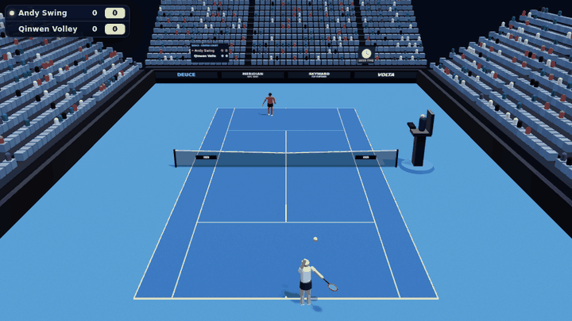

# DEUCE — AI tennis that teaches itself



**▶ Play / watch live: [brooks-cart-condos-temporal.trycloudflare.com](https://brooks-cart-condos-temporal.trycloudflare.com)**
<sub>Temporary address: it is served from the training PC through a Cloudflare quick tunnel and changes when that PC restarts.</sub>

Two AI players learn tennis by playing each other (self-play neuroevolution). Champions are saved
as they improve and become 10 difficulty levels you can play against in the browser.

* **Watch AI** – the newest champion against a strong older one, live, at 1×–8× speed.
* **Play vs AI** – pick level 1–10 and play from the near baseline (keyboard + mouse, or touch).

## Run
```bash
docker compose up -d --build        # http://localhost:8452
docker logs deuce-tunnel 2>&1 | grep trycloudflare   # temporary public HTTPS link
```
Training progress is stored in `./data` (not in git).

## How it works
* `shared/tennis.js` – the whole game, shared by trainer and browser: ball flight with drag and
  topspin/slice, bounces, net, lines, serves and faults, tennis scoring, the shot model (harder,
  running or stretched shots are less accurate) and the players' neural networks.
* `server/trainer.js` – population of 128 brains; every generation each plays short matches against
  rivals and saved champions; the best breed (crossover + mutation). Every 15 generations the
  champion enters the hall of fame and gets an Elo rating; the hall provides the difficulty levels.
* `server/index.js` – serves the viewer and `/api/status`, `/api/showcase`, `/api/levels`, `/api/reset`.
* `public/` – three.js stadium, procedural players and animation, HUD, controls, synthesised sound.

Controls: WASD/arrows move · mouse aims on the far court · hold Space = lob · hold Shift = slice ·
click/Enter = serve. On phones: joystick, tap to aim, SERVE / LOB / SLICE buttons.

All sponsors and names in the stadium are fictional.
